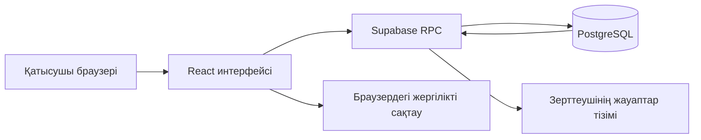

# Lingualyze

**Lingualyze** — қазақ тіліндегі сөйлемдерді түсіну мен сөз тәртібін өңдеуді зерттеуге арналған веб-қосымша. Қатысушылар сөйлемдерді оқып, тапсырмаларды орындайды; зерттеуші олардың жауаптарын, оқу уақытын және нәтижелерін қарайды.

Интерфейс қазақ, орыс және ағылшын тілдерін қолдайды. Негізгі зерттеу материалдары қазақ тілінде берілген.

## Қосымша қалай жасалған?

Жоба **React + TypeScript** негізінде құрылған. **Vite** клиенттік кодты құрастырады, **Tailwind CSS** интерфейсті безендіреді, ал **Supabase PostgreSQL** қатысушылар мен жауаптарды сақтайды. Өндірістік нұсқа **Vercel** арқылы жарияланады.

| Құрал | Жобадағы міндеті |
| --- | --- |
| React 19 | Экрандар, компоненттер және интерфейс күйі |
| TypeScript | Қатысушы, сөйлем, жауап және сынақ деректерінің типтері |
| Vite 6 | Әзірлеу ортасы және өндірістік жинақ |
| Tailwind CSS 4 | Бейімделетін дизайн, ашық және қараңғы тақырыптар |
| Supabase / PostgreSQL | Деректерді сақтау және RPC функциялары арқылы тексеру |
| Express | Жергілікті әзірлеу сервері және Node.js ортасында статикалық файлдарды ұсыну |
| Motion, Lucide React, Three.js | Анимациялар, белгішелер және үшөлшемді логотип |
| Web Audio API | Тапсырма кезіндегі дыбыстық белгілер |

## Архитектурасы



`src/App.tsx` тіл, тақырып, белсенді бөлім, қатысушы профилі және зерттеуші рөлін басқарады. Қосымша бөлімдерді күй арқылы ауыстыратын бір беттік интерфейс ретінде жұмыс істейді.

### Қатысушының жолы

1. Қатысушы аты-жөнін, телефон нөмірін, жасын және тілдік тобын енгізеді.
2. Браузер қатысушыға бірегей ID және құпия токен жасайды.
3. `save_participant` RPC функциясы профильді базаға сақтайды. Қайта жазу үшін сол қатысушының токені қажет.
4. `ExperimentRunner.tsx` сөйлемдерді көрсетіп, оқу және жауап беру уақытын тіркейді.
5. Әр сөйлемнің нәтижесі `save_test` арқылы сақталады. Желіге жіберу сәтсіз болса, жазба браузердің жергілікті сақтауында қалады; зерттеуші оны серверге жеткен дерекпен шатастырмауы керек.

Сөйлемдер **SOV, OSV, SVO және OVS** сөз тәртіптерімен, сондай-ақ CEFR деңгейі, ұзындығы және күрделілігі бойынша сипатталады. Тапсырмаларда сөз тізбегін таңдау, эмодзи тізбегін реттеу және жалғаулардың мағынасын ажырату қолданылады. Бастапқы материалдар `src/data/sentences.ts`, кеңейтілген сөйлемдер генераторы `src/data/stimuliGenerator.ts` ішінде орналасқан.

### Зерттеушінің жолы

Зерттеуші логин мен құпиясөз арқылы кіреді. `researcher_login` функциясы құпиясөз хэшін тексеріп, 8 сағатқа жарамды кездейсоқ сессия токенін қайтарады. Кейінгі зерттеу сұраулары сол токенмен орындалады. Шығу кезінде `researcher_logout` сессияны жояды.

`AnswersView.tsx` тіркелген қатысушылар мен демо профильдерді бір ізделетін тізімге біріктіреді. Тестті әлі бастамаған адамдар да көрсетіледі. Тізімді барлық қатысушылар, еріктілер немесе демо қатысушылар бойынша сүзуге болады. Нақты жауаптар мен демо жауаптардың саны бөлек көрсетіледі.

## Дерекқор құрылымы

| Кесте немесе көрініс | Мазмұны |
| --- | --- |
| `public.participants` | Қатысушы профилі және оның құпия токенінің хэші |
| `public.tests` | Қатысушы ID-іне байланыстырылған сөйлем нәтижелері, уақыттар және жауаптар |
| `private.researcher_accounts` | Зерттеуші логиндері және құпиясөз хэштері |
| `private.researcher_sessions` | Сессия токендерінің хэштері мен жарамдылық мерзімі |
| `private.researcher_passcodes` | Бұрынғы ортақ кіру кодтарын қолдау |
| `private.research_demo` | Арнайы белгіленген жасанды демо профильдер мен жауаптар |
| `public.research_participant_directory` | Қатысушылар мен демо профильдердің біріктірілген әкімшілік көрінісі |

`tests.participant_id` сыртқы кілті `participants.id` өрісіне сілтейді. Қатысушы мен оның жауаптары осы байланыс арқылы біріктіріледі.

**Supabase Authentication бөліміндегі Users тізімі бұл кестелерден бөлек.** Қазіргі тіркелу жолы Supabase Auth аккаунтын жасамайды: қатысушыға қолданбаның өз ID-і мен токені беріледі. Сондықтан Authentication тізімінің бос болуы қатысушылар базасының бос екенін білдірмейді. Қатысушыларды Supabase Table Editor ішіндегі `participants`, `tests` және `research_participant_directory` арқылы тексеруге болады.

### Қолжетімділік

Клиент Supabase-ке `src/utils/db.ts` ішіндегі жоба URL-і мен жарияланатын кілт арқылы қосылады. Бұл кілт әкімшілік құпия кілт емес. `participants` пен `tests` кестелерінде RLS қосылған; клиенттік оқу және жазу операциялары тексеру жүргізетін RPC функциялары арқылы орындалады. `private` схемасына клиенттік рөлдердің тікелей рұқсаты жоқ. Біріктірілген әкімшілік көрініске де жалпы клиенттік оқу рұқсаты берілмейді.

Құпиясөздерді, қатысушы токендерін және `service_role` кілтін GitHub-қа немесе клиенттік кодқа қоспау керек. Зерттеуші аккаунтын әкімші жеке түрде жасайды; оның құпиясөзі миграция файлдарында сақталмайды.

### Демо деректер

Демо профильдерде кәдімгі қазақша есімдер қолданылғанымен, олар **жасанды мысалдар** және интерфейсте `DEMO` белгісімен көрсетіледі. Оларға шынайы телефон нөмірлері қосылмайды.

Демо жауаптар `private.research_demo` ішінде сақталады. Біріктірілген тізім оларды тек көрсету үшін қосады: олар `public.tests` кестесіне, негізгі `research_data` жауабына немесе нақты зерттеу экспортына көшірілмейді.

## Жоба файлдары

```text
src/
  App.tsx                         # Қосымшаның негізгі күйі мен бөлімдері
  types.ts                        # Ортақ TypeScript типтері
  components/
    ParticipantOnboarding.tsx     # Қатысушыны тіркеу
    ExperimentRunner.tsx          # Тапсырмалар мен уақыт өлшеу
    AuthModal.tsx                 # Зерттеушінің кіру терезесі
    AnswersView.tsx               # Біріктірілген қатысушылар тізімі
    DemoAnswerSheet.tsx           # Демо жауаптарды көрсету
    AnalyticsDashboard.tsx        # Талдау және экспорт
  data/
    sentences.ts                  # Бастапқы қазақша сөйлемдер
    stimuliGenerator.ts           # Кеңейтілген тапсырмалар генераторы
    translations.ts               # Интерфейс аудармалары
  utils/
    db.ts                         # Supabase RPC сұраулары
    storageEngine.ts              # Жергілікті сақтау және сервермен алмасу
    researchDirectory.ts          # Қатысушылар мен демо тізімін біріктіру
    statistics.ts                 # Статистикалық есептеулер
supabase/migrations/               # Дерекқор құрылымы және демо деректер
server.ts                         # Express сервері
vite.config.ts                    # Vite және Tailwind баптауы
```

## Жергілікті іске қосу

Node.js пен npm орнатылған болуы керек.

```bash
git clone https://github.com/confidness/lingualyze.git
cd lingualyze
npm install
npm run dev
```

Қосымша `http://localhost:3000` мекенжайында ашылады.

Басқа Supabase жобасын қолдану үшін `src/utils/db.ts` ішіндегі URL мен жарияланатын кілтті сол жобаға ауыстырыңыз. Жаңа базада `supabase/migrations/` файлдарын уақыт ретімен қолданыңыз. Бұрын орындалған миграцияны қолмен қайта іске қоспас бұрын оның тарихын тексеріңіз: бастапқы файлдардың кейбірі қайта орындауға арналмаған.

Қоймадағы `.env.example` файлында бұрынғы AI Studio ортасынан қалған Gemini және APP_URL үлгілері бар. Қазіргі негізгі тест пен Supabase RPC ағыны бұл айнымалыларды қолданбайды; тестті іске қосу үшін Gemini кілті қажет емес.

### Тексеру және жинақтау

```bash
npm run lint
npx tsx src/utils/statistics.check.ts
npx tsx src/utils/researchDirectory.check.ts
npm run build
```

`lint` командасы TypeScript тексеруін орындайды. `build` клиентті `dist/` ішіне жинап, Express серверін `dist/server.cjs` файлына құрастырады.

Node.js сервері арқылы өндірістік нұсқаны іске қосу мысалы:

```bash
NODE_ENV=production npm start
```

PowerShell ортасында:

```powershell
$env:NODE_ENV = 'production'
npm start
```

## Vercel арқылы жариялау

Бұл жобада GitHub-тың `main` тармағына жіберілген өзгерістер Vercel өндірістік жинағын іске қосады. Клиенттік жинақ үшін Vite қолданылады, шығыс бумасы — `dist`.

**GitHub-қа код жіберу Supabase SQL миграциясын өздігінен орындамайды.** Дерекқор өзгерістерін Supabase-ке бөлек қолдану керек. Код, миграция және өндірістік жинақтың күйі жеке тексеріледі.

## Өлшеу мен талдаудың шектеулері

Қосымша браузерде тіркелген оқу және жауап беру уақыттарын пайдаланады. Бұл көрсеткіштер ми белсенділігін тікелей өлшемейді; құрылғы, браузер және қатысушы әрекеттері уақытқа әсер етуі мүмкін.

Кодта бастапқы үлгі сынақтары, ғылыми бағдарлық мәндер және алдын ала берілген статистикалық түсіндірмелер де бар. Атап айтқанда, `analyzeSessionData` ішіндегі кейбір F, p және әсер мөлшері мәндері толық статистикалық тесттен есептелмейді. Ғылыми жарияланымға арналған қорытындыны нақты еріктілердің тексерілген экспорты бойынша бөлек есептеу қажет.
